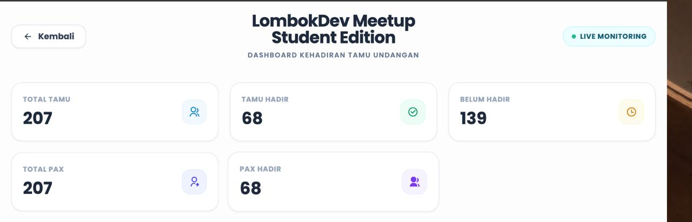

# Peserta

[← Kembali](README.md)

## Ringkasan

| | |
|---|---|
| Pendaftar | 200 orang |
| Hadir (check-in) | 68 orang |
| Bertahan sampai akhir & mengisi evaluasi | 64 orang (94%) |

## Asal Pendaftar

| Instansi | Jumlah | % |
|---|---:|---:|
| Universitas Bumigora | 118 | 59,0% |
| Universitas Hamzanwadi | 21 | 10,5% |
| Universitas Mataram | 20 | 10,0% |
| Universitas Muhammadiyah Mataram | 13 | 6,5% |
| UIN Mataram | 5 | 2,5% |
| SMKN 2 Mataram | 4 | 2,0% |
| STMIK Lombok | 3 | 1,5% |
| Kampus lain (8 kampus) | 9 | 4,5% |
| SMA/SMK lain | 4 | 2,0% |
| Umum | 3 | 1,5% |
| **Total** | **200** | **100%** |

41% pendaftar berasal dari luar Universitas Bumigora.

## Asal Peserta Hadir

Dari 64 peserta yang mengisi evaluasi:

| Instansi | Jumlah |
|---|---:|
| Universitas Bumigora | 48 |
| Universitas Mataram | 6 |
| Universitas Hamzanwadi | 4 |
| SMKN 2 Mataram | 2 |
| UIN Mataram, STMIK Lombok, UNIQHBA, lainnya | 4 |

## Capaian Target

| Target | Hasil | |
|---|---|---|
| 200 peserta hadir | 68 peserta | ❌ |
| 4 kampus terlibat lewat pemateri | 4 kampus | ✅ |
| 4 pemateri mahasiswa tampil | 4 pemateri | ✅ |
| ≥80% peserta ikut sampai selesai | 94% | ✅ |
| ≥50% peserta isi evaluasi | 94% | ✅ |
